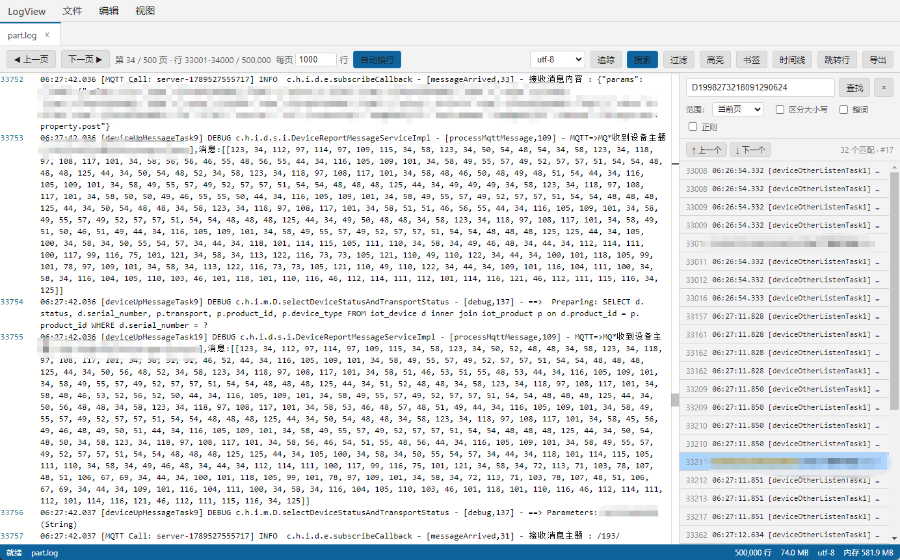

# LogView

[简体中文](README.md) | English

A professional Windows desktop log analysis tool.

Built with **Electron + React + Monaco Editor**, designed for viewing and analyzing large log files — featuring paginated browsing of huge files, real-time tailing, full-file / current-page search, coloring rules, timeline view, bookmarks, and more.

> The product name `LogView` is kept as-is; the UI is fully localized in Chinese.

## 🖼️ Screenshot



Main window: paginated log browsing + toolbar (paging / page size / word wrap / encoding / tail / search / filter / highlight / bookmarks / timeline / goto line / export). The right-hand search panel supports virtualized scrolling and prev/next match navigation. The bottom status bar shows the file, total lines, size, encoding, and memory usage.

---

## ✨ Features

- **Large-file paging engine**: byte-offset line index (built progressively) enables smooth browsing of huge logs (GB-scale). Default 1,000 lines per page (adjustable 500–2,000); the status bar shows "Indexing…" while the index is being built. The line index is written directly into a growable TypedArray, keeping indexing speed and memory footprint friendly even for files with hundreds of millions of lines; the index and file-handle caches are released as soon as a tab is closed.
- **Automatic encoding detection**: powered by `jschardet` + `iconv-lite` — auto-detects GBK / UTF-8 / other encodings and decodes correctly.
- **Search**
  - Current-page search (default; zero file I/O, millisecond-level; supports regex / case-sensitive / whole word).
  - Whole-file search (streaming scan).
  - Jump between results (F3 / Shift+F3).
  - Virtualized result list: tens of thousands of matches render smoothly.
- **View filter**: stream-scan the whole file by keyword, in either "keep matching lines" or "hide matching lines" mode (with regex / case-sensitive / whole word); virtualized result list; click any line to jump to its position in the original file.
- **Real-time tail (tail -f)**: watches file increments and appends new log lines automatically (batched flush per time window, no lag under high write rates); detects log rotation.
- **Word wrap**: one-click toggle in the toolbar to wrap long lines; applies globally and is persisted.
- **Coloring rules**: custom regex rules to highlight matching lines with foreground / background colors (e.g. mark `ERROR` lines red).
- **Timeline view**: parses timestamps (ISO 8601, syslog, Apache, etc.) and visualizes them; click to jump to the corresponding line.
- **Bookmarks**: add / remove bookmarks on any line and navigate quickly via the bookmark panel (Ctrl+F2).
- **Multi-file tabs**: open multiple log files at once; tabs don't interfere with each other.
- **Goto line**: jump by line number (Ctrl+G).
- **Export**: export search results to a file.
- **Fully portable**: single-file, installation-free — double-click to run. Settings are stored next to the exe; copy the whole folder to migrate.

---

## 🧰 Tech Stack

| Category | Choice |
| --- | --- |
| Desktop framework | Electron 30 (sandbox + contextIsolation) |
| Frontend | React 18 + TypeScript + Zustand |
| Editor | Monaco Editor (VS Code core) |
| Build | electron-vite |
| Packaging | electron-builder (Windows portable / NSIS) |
| Encoding detection | jschardet + iconv-lite |
| File watching | chokidar |

---

## 📋 Requirements

- **Node.js**: 18.x or 20.x recommended (compatible with Electron 30)
- **npm**: installed with Node
- **OS**: Windows for development (current packaging target is Windows x64)

---

## 🚀 Getting Started

### 1. Install dependencies

```bash
npm install
```

> If downloading the Electron binary from GitHub fails (`E_FAIL` / `Electron uninstall`), set a mirror first and retry:
> ```bash
> set ELECTRON_MIRROR=https://npmmirror.com/mirrors/electron/
> node node_modules/electron/install.js
> ```

### 2. Run in development

```bash
npm run dev
```

HMR is supported; main-process file changes trigger an automatic rebuild and restart.

### 3. Build (compile only, no packaging)

```bash
npm run build
```

### 4. Package as a Windows portable exe (single file, installation-free)

**Option 1: double-click `package.bat`** (recommended; mirror and compression settings included).

**Option 2: command line** (run as a single line; note there is no space around `&&`):

```bat
set ELECTRON_BUILDER_BINARIES_MIRROR=https://cdn.npmmirror.com/binaries/electron-builder-binaries/&&set ELECTRON_BUILDER_COMPRESSION_LEVEL=1&&npm run package > log\package.log 2>&1
```

After a successful build, the output is at `dist/logview-1.0.0-portable.exe` — double-click to run.

> See [`doc/运行与打包.md`](doc/运行与打包.md) (Chinese) for detailed packaging configuration, mirror-variable pitfalls, and offline fallbacks.

---

## ⌨️ Keyboard Shortcuts

| Shortcut | Action |
| --- | --- |
| `Ctrl+O` | Open log file |
| `Ctrl+F` | Search |
| `Ctrl+G` | Goto line |
| `Ctrl+F2` | Add / remove bookmark on current line |
| `F3` / `Shift+F3` | Search: next / previous match |
| `PageUp` / `PageDown` | Previous / next page |
| `Ctrl+0` / `Ctrl++` / `Ctrl+-` | Reset / zoom in / zoom out |
| `F11` | Toggle fullscreen |
| `F5` / `Ctrl+R` | Reload |
| `F12` | Open DevTools |
| `Esc` | Close current side panel or dialog |

> Window-level actions (reload, fullscreen, zoom, quit, etc.) and the file dialog are implemented via main-process IPC; the menu is renderer-drawn (HTML/CSS) with freely adjustable font size.

---

## 📁 Data Directory (Portable Edition)

Program settings (theme, page size, coloring rules, recent files, etc.) are persisted by `electron-store`:

- **Development (`npm run dev`)**: written to `AppData\Roaming\LogView\logview-settings.json`, keeping the project directory clean.
- **Portable exe**: written to `logview-settings.json` **next to the exe**.

Copy the exe to any writable directory (local folder, USB drive, etc.) and double-click to run; data lives alongside the exe, so copy / delete the folder to migrate or clean up.

> ⚠️ Run the exe from a **writable directory** (not `C:\Program Files\` or other system locations), otherwise settings cannot be saved.
> ⚠️ If you manually switched the theme earlier, `logview-settings.json` next to the exe may contain `theme:dark`; delete the file (or the `theme` field) to restore the default light theme.

---

## 📂 Project Structure

```
logview/
├─ src/
│  ├─ main/            # Main process: file reading / encoding / paging index / search / filter / tail / timeline / settings / IPC
│  ├─ preload/         # Preload script (API exposed via contextBridge)
│  ├─ shared/          # Constants, types, and IPC channels shared between main and renderer
│  └─ renderer/        # Renderer process: React + Zustand + Monaco
├─ out/                # Build output (generated by build/dev)
├─ dist/               # Packaging output (portable exe)
├─ log/                # Build / package / run logs (ignored by .gitignore)
├─ test/               # Test files (scripts, mocks, sample logs, etc.)
├─ doc/                # Docs (build & packaging guides, implementation plans, screenshots)
│  └─ images/          # Screenshots referenced by the READMEs
├─ electron.vite.config.ts
├─ electron-builder.yml
├─ package.bat
└─ package.json
```

---

## ❓ FAQ

**Q: `npm run dev` fails with `Error: Electron uninstall`?**
A: The Electron binary wasn't downloaded. Set the `ELECTRON_MIRROR` mirror, then run `node node_modules/electron/install.js` again.

**Q: Packaging fails to download (404 / EBUSY)?**
A: Download failures are usually caused by trailing spaces in mirror URLs (see the "mirror variable pitfall" section in `doc/运行与打包.md`, in Chinese); `EBUSY` usually means the old exe is still running and locking `dist/win-unpacked` — run `taskkill /IM "logview-1.0.0-portable.exe" /F` first.

**Q: Opening a huge log file is slow?**
A: The app builds a paginated byte-offset line index first (the status bar shows "Indexing…"); once done, browsing is smooth.

**Q: Is the UI in English?**
A: The UI is fully localized in Chinese. Monaco Editor's built-in menus are localized automatically by Electron according to the system language.

---

## 📄 License

MIT
